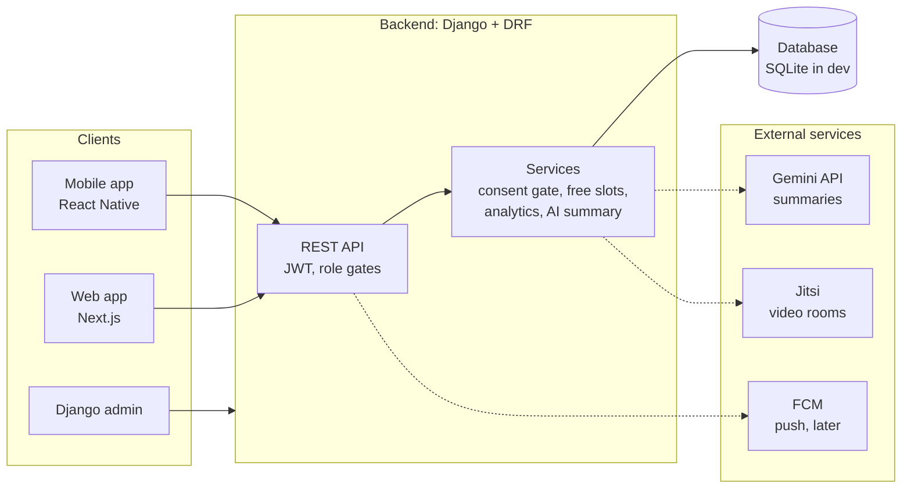
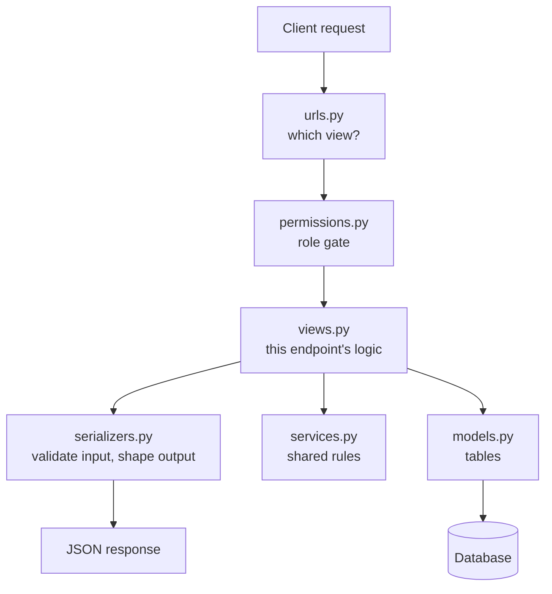
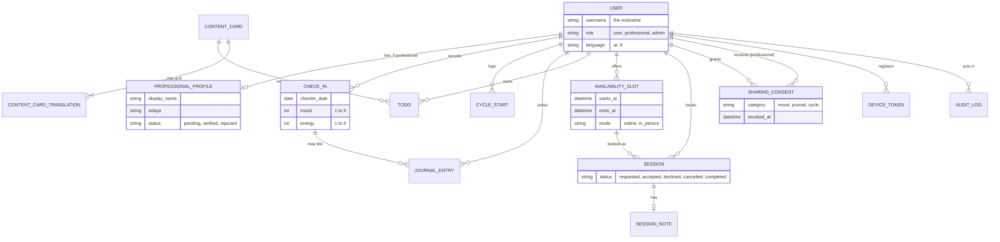
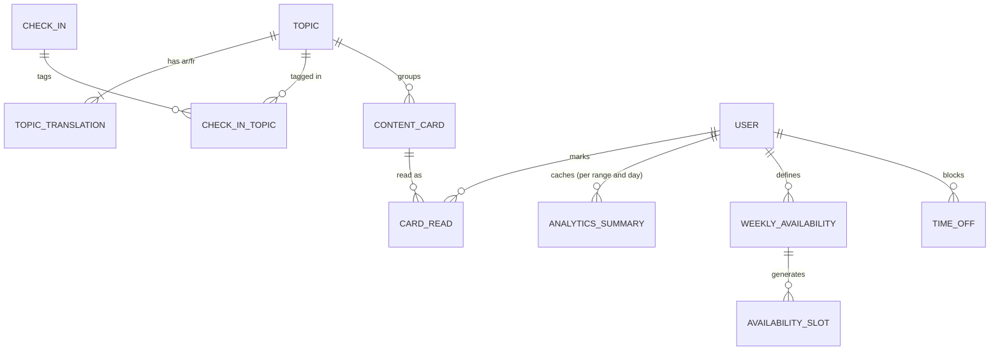
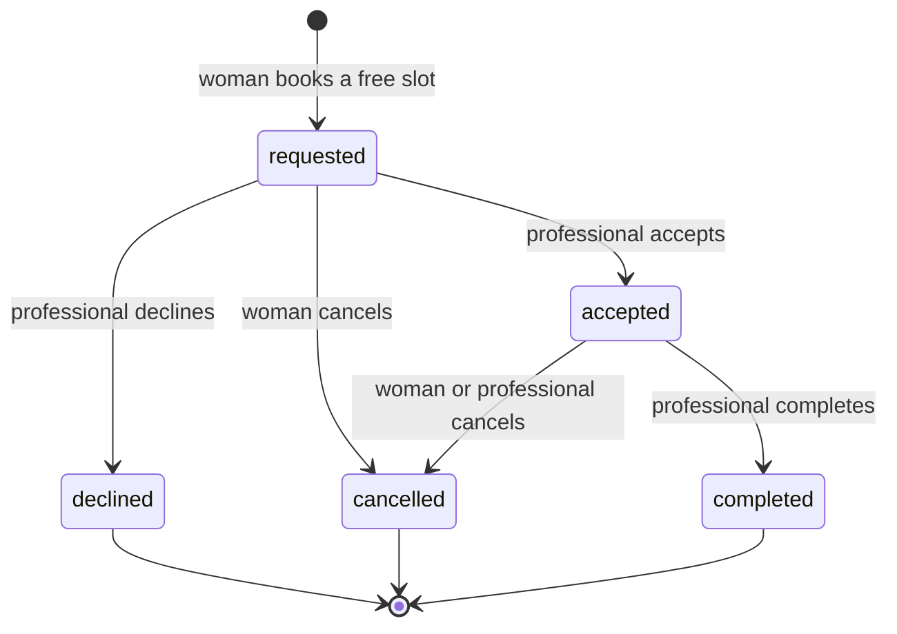
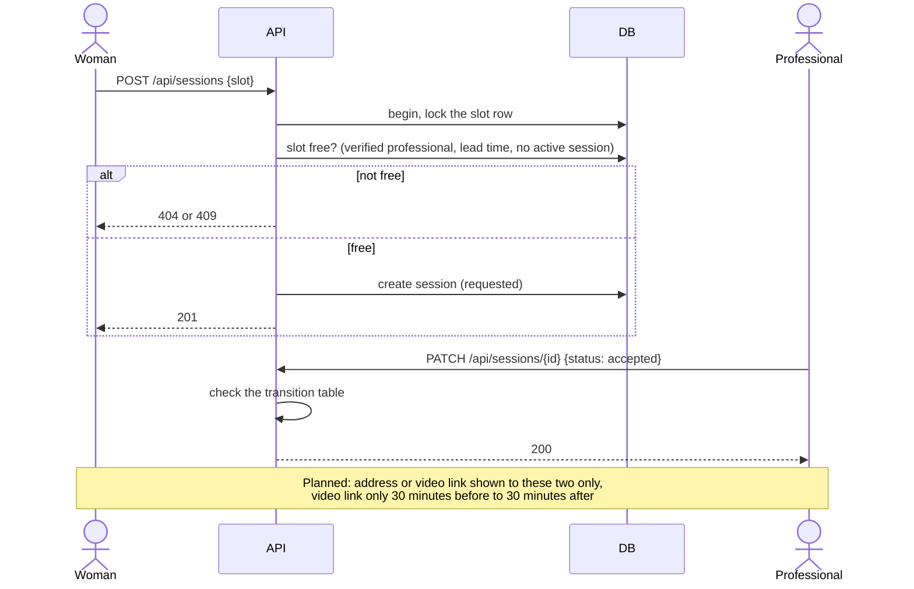
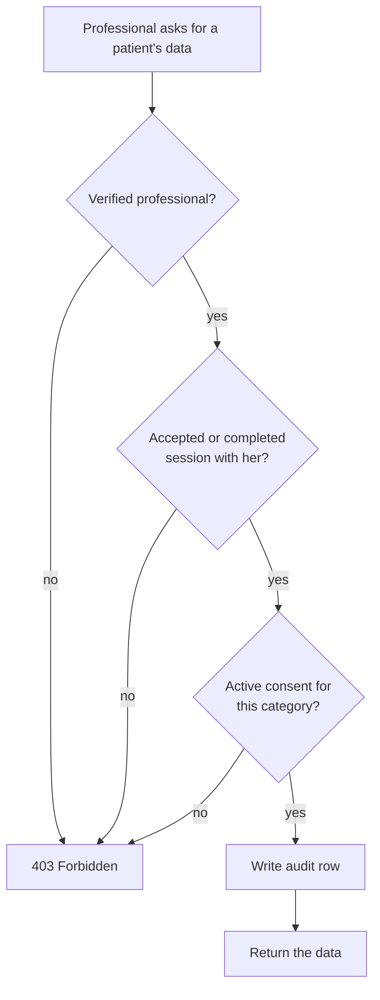
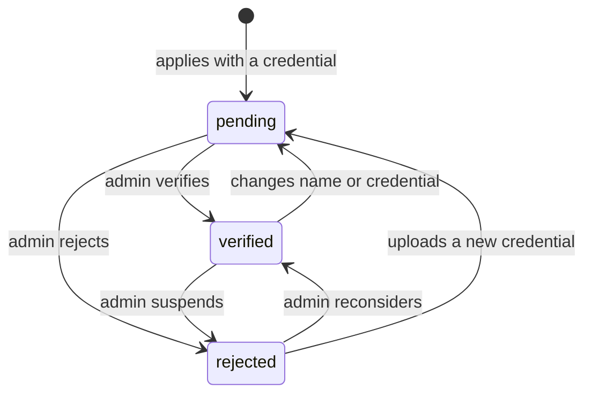
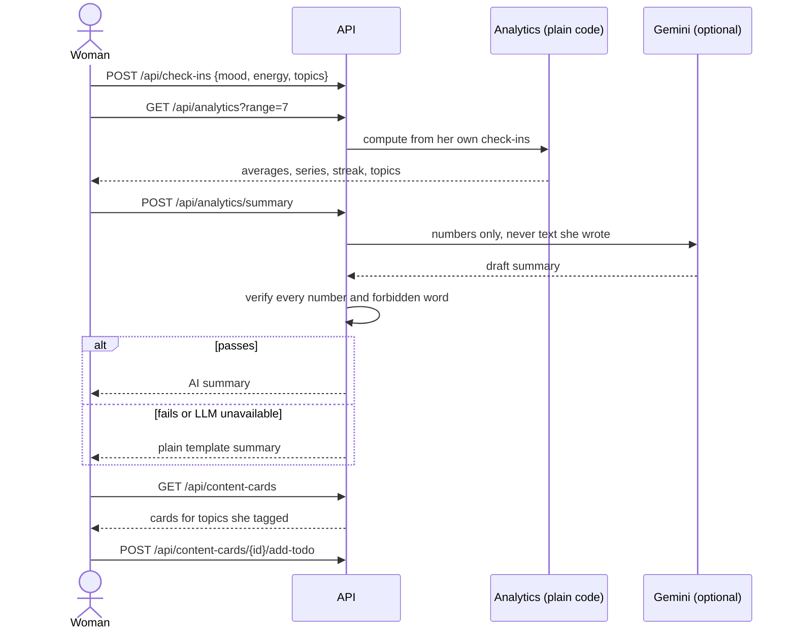
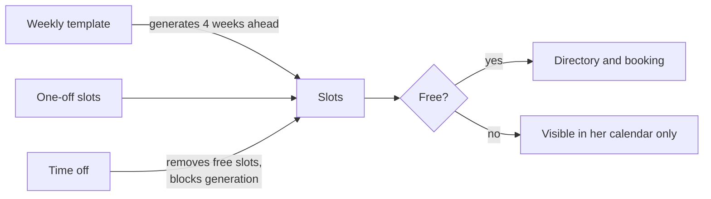

# Rahati

A private mental-wellbeing platform for Algerian women. A woman can understand her own emotional patterns through daily check-ins and her own numbers, learn from short educational cards, and, when she wants, reach a verified woman mental-health professional and book a session online or in person.

> **Status: work in progress.** 

---

## Table of contents

1. [Principles](#principles)
2. [What the product does](#what-the-product-does)
3. [Status](#status)
4. [Architecture](#architecture)
5. [Backend structure](#backend-structure)
6. [Data model](#data-model)
7. [Key flows](#key-flows)
8. [Roles and permissions](#roles-and-permissions)
9. [API overview](#api-overview)
10. [Security and privacy](#security-and-privacy)
11. [Getting started](#getting-started)
12. [Testing](#testing)
13. [Key decisions](#key-decisions)
14. [Roadmap](#roadmap)
15. [Contributing](#contributing)
16. [Glossary](#glossary)

---

## Principles

These rules decide every design question. If a feature breaks one, the feature changes.

- **Show, don't diagnose.** The app shows a woman her own numbers. It never labels her, never says she has a condition and never gives medical advice.
- **No model training.** Insights are plain statistics. AI is used only to put those statistics into words, and every AI sentence is checked by code before she sees it.
- **Anonymous by default.** A nickname is enough to sign up. Email and phone are optional.
- **Her data, her consent.** A professional sees a woman's data only with an accepted session and an explicit, revocable consent for each category (mood, journal, cycle).
- **Delete means delete.** One action removes everything she owns.
- **A woman does not face barriers to help.** Finding a professional is facilitated 

## What the product does

Rahati has two modes that share one account.

**Preventing: understand yourself.**
Check in (mood, energy, optional cycle day and topics on her mind), see her own analytics, ask for a short AI summary of those numbers, learn something from a short card, take one small action.

**Healing: reach a professional.**
Find a verified woman professional by mode, wilaya and time, book a free slot, share only what she chooses, and get the address or video link once the session is accepted.

Three personas use the platform:

| Persona | Uses | Does |
|---|---|---|
| **Woman (user)** | Mobile app| Tracks, learns, books, controls her sharing |
| **Professional** | Web dashboard | Manages availability, accepts sessions, sees consented data, assigns cards and to-dos |
| **Admin** | Django admin | Verifies professionals, manages content, reads the audit log |


## Architecture




### How a request is handled



Every view passes three gates:

1. **Role gate**: is this the right kind of person? (`permissions.py`)
2. **Ownership**: every query is scoped to `request.user`, and "not yours" returns the same 404 as "does not exist".
3. **Consent gate**: a professional reads a woman's data only with a relationship and an active consent (`services.can_read`).

## Backend structure

```
Rahati/
├── README.md
├── LICENSE
├── pyproject.toml, uv.lock
└── Backend/
    ├── manage.py
    ├── config/               settings.py, urls.py
    └── rahati/
        ├── models.py         the tables
        ├── serializers.py    validation and response shapes
        ├── permissions.py    role gates
        ├── services.py       consent gate, relationship check, audit
        ├── views.py          one class per endpoint
        ├── urls.py           routes only
        ├── admin.py          the admin persona
        └── tests/            automated tests
```


## Data model

### Core (built)



Design notes:

- **Third normal form.** the database is normelized to the third normal form for coherance and integrity
- **Encrypted columns:** journal text and session notes are encrypted before they reach the database.
- **Deletion:** every table that belongs to a woman cascades from `USER`. The audit log keeps its rows but loses the link to her (`SET NULL`).
- **Translations** live in their own table, so adding a language adds rows, not columns.

### Planned additions



## Key flows

### Session lifecycle

A session in `requested` or `accepted` holds its slot. When it becomes declined, cancelled or completed, the slot is free again (completed sessions stay in history).



### Booking and reveal



**A free slot** is: at least 60 minutes in the future, belongs to a verified and active professional, is not closed, and has no requested or accepted session. Search, calendar and booking all use this one rule.

### Consent gate



### Professional verification



An unverified or suspended professional cannot publish slots, accept sessions or read patient data, and her slots are not free for women.

### The Preventing loop (planned)



### Availability (planned)



A slot that has ever had a session is closed, never deleted, so booking history is never lost.

## Roles and permissions

| Action | Woman | Professional (verified) | Professional (pending or rejected) | Admin |
|---|---|---|---|---|
| Register | yes, public | yes, as an application | n/a | created by operators |
| Track, journal, to-dos | own data only | no | no | no |
| Book and cancel sessions | yes | no | no | no |
| Publish slots, accept sessions | no | yes | no | no |
| Read a woman's mood, journal or cycle | no | only with relationship + consent | no | no |
| Assign to-dos and cards | no | to her own patients | no | no |
| Verify professionals, manage cards | no | no | no | yes |
| Read the audit log | no | no | no | yes (read-only) |
| Read journals, check-ins, notes | own only | consented only | no | no |

## API overview

All routes are under `/api/`. Responses are JSON. Authentication is a JWT in the `Authorization: Bearer` header.

### Built

| Area | Endpoints |
|---|---|
| Auth and account | `POST auth/register`, `POST auth/login`, `POST auth/refresh`, `GET /me`, `DELETE /me` |
| Tracking | `GET/POST check-ins`, `POST cycle-starts`, `GET/POST journal` |
| To-dos | `GET/POST todos`, `POST todos/{id}/complete` |
| Content | `GET content-cards` |
| Finding a professional | `GET professionals`, `GET professionals/{id}/slots` |
| Sessions | `GET/POST sessions`, `PATCH sessions/{id}` |
| Consent | `GET/PUT consents` |
| Professional | `GET/POST pro/slots`, `GET pro/patients`, `GET pro/patients/{id}/check-ins`, `.../journal`, `.../cycle`, `POST pro/patients/{id}/todos`, `GET/PUT pro/sessions/{id}/note` |
| Professional signup and profile | see `rahati/urls.py` |

`GET patterns` exists but is deprecated.

### Specified (not yet built)

| Area | Endpoints |
|---|---|
| Analytics | `GET analytics?range=7\|30\|90`, `POST analytics/summary`, `GET pro/patients/{id}/analytics` |
| Topics and cards | `GET topics`, `GET content-cards/library`, `GET content-cards/{id}`, `POST content-cards/{id}/read`, `POST content-cards/{id}/add-todo` |
| Professional assigns | `POST pro/patients/{id}/content`, `GET pro/patients/{id}/todos` (progress) |
| Directory | `GET wilayas`, `GET professionals?mode&wilaya&from&to&time_of_day`, `GET professionals/{id}/calendar` |
| Sessions | `GET sessions/{id}` with `location` and `online` objects |
| Availability | `GET/POST/PATCH/DELETE pro/availability`, `PATCH/DELETE pro/slots/{id}`, `GET/POST/DELETE pro/time-off`, `GET pro/calendar` |

A machine-readable API schema (Swagger, via `drf-spectacular`) is the next contract for the mobile and web developers. It must not be public in production.

## Security and privacy

The security model follows **OWASP Top 10:2025** and the **OWASP API Security Top 10:2023**. Because an LLM is involved, the **OWASP Top 10 for LLM Applications** applies to the summary feature.

### What is in place

- Role gates, ownership scoping and a consent gate on every endpoint (A01, API1, API5).
- Journal text and session notes are encrypted at rest (A04).
- Responses are explicit allow-lists, with no emails, phones or file paths leaking (API3).
- Booking uses a row lock so a slot cannot be double-booked.
- Professional reads of a woman's data are written to an audit log (A09).
- Administrators cannot open check-ins, journals or session notes.

### What the specified features add

- The AI receives **numbers and topic codes only**. No text she wrote ever reaches the model (LLM01, LLM02).
- Every AI sentence is verified. On any doubt the app uses a plain template instead (LLM05, API10).
- Cached summaries, daily call caps and throttles limit cost and abuse (LLM10, API4).
- Video links are an HMAC of the session id with a server secret, never stored, and shown only to the two participants inside a time window (A04, A01).
- Directory searches are validated against allow-lists, capped, throttled and never logged (A05, API4, API6, A09).
- Slots with history are closed, not deleted (A08).

### Before any real woman uses the app (demo-minimum)

1. Secrets out of the code: `SECRET_KEY`, `DEBUG`, `ALLOWED_HOSTS` from `.env`; `.env` and `db.sqlite3` in `.gitignore`.
2. Deny by default: `DEFAULT_PERMISSION_CLASSES = IsAuthenticated`.
3. Fix three known bugs: women can write `card` on their own to-dos; a suspended professional can still act; a duplicate email returns a 500.
4. Token lifetimes: 15-minute access, 7-day refresh with rotation.
5. Throttle login and registration.
6. `DELETE /me` requires the password.
7. Lock CORS to the front-end URL.
8. Run `uv run pip-audit` and `uv run bandit -r rahati -x rahati/tests` once.

### Before a real launch

The full baseline: CI, immutable audit log, encryption key rotation, an admin IP allow-list and login throttling, a role-by-route test matrix, structured logging with redaction, and a `SECURITY.md` mapping every OWASP item to code and tests.

### Accepted risks (for now)

- Mood and cycle data are not encrypted per column (they are needed for aggregation). The database disk and backups must be encrypted at the hosting level.
- Integer ids are sequential; object-level checks are the protection.
- The public Jitsi server lets anyone holding a link join. Self-host it or add Jitsi authentication before a real launch.
- Administrators have no two-factor login yet.
- Wilaya, address and other professional details are only as trustworthy as the manual verification of her credential. A human must check a diploma against the official body.

## Getting started

Requirements: Python 3.11 or newer and [uv](https://docs.astral.sh/uv/).

```bash
# from the repo root
uv sync

cd Backend
```

Create `Backend/.env`:

```
FIELD_ENCRYPTION_KEY=<generate it, see below>
```

Generate the encryption key:

```bash
uv run python -c "from cryptography.fernet import Fernet; print(Fernet.generate_key().decode())"
```

> **Back up this key.** If it is lost, every journal entry and session note becomes unreadable.

Required settings in `Backend/config/settings.py` (the project reads them at the bottom of the file):

```python
AUTH_USER_MODEL = "rahati.User"          # must be set before the first migration
FIELD_ENCRYPTION_KEY = os.environ["FIELD_ENCRYPTION_KEY"]
TIME_ZONE = "Africa/Algiers"
INSTALLED_APPS += ["rest_framework", "corsheaders", "rahati"]
```

Create the tables and an administrator:

```bash
uv run python manage.py makemigrations rahati
uv run python manage.py migrate
uv run python manage.py createsuperuser
uv run python manage.py shell -c "from rahati.models import User; User.objects.filter(is_superuser=True).update(role='admin')"
uv run python manage.py runserver
```

- Admin: `http://127.0.0.1:8000/admin/`
- API: `http://127.0.0.1:8000/api/`

**Do not commit** `.env`, `db.sqlite3`, `private_media/` or `media/`. If `db.sqlite3` was committed by mistake, run `git rm --cached Backend/db.sqlite3`.

## Testing

```bash
cd Backend
uv run python manage.py test rahati
```

Coverage (once `coverage` is installed as a dev dependency):

```bash
uv run coverage run manage.py test rahati
uv run coverage report --include="rahati/*"
```

The tests protect the rules that matter most: consent, encryption at rest, deletion, booking correctness and who may do what. Tests are deterministic: time is frozen, there are no network calls, and the AI is replaced by a fake in every test.

## Key decisions

| Decision | Why |
|---|---|
| Rules and statistics, not machine learning | No real data yet, and a model trained on invented data proves nothing. Rules are explainable. |
| Show analytics instead of detecting "patterns" | Avoids clinical judgment, false alarms and responsibility for being right. |
| Cards by topic the woman tags, plus cards her professional assigns | The app never claims to know her state. She tells it, or her professional decides. |
| No filtering professionals by symptom, specialty, language or rating | A woman seeking help may not know what is wrong; ratings invite unfairness. |
| One user table with a role field | Three personas, one login system, one permission model. |
| Slots are closed, never deleted, after a booking | Deleting would cascade and erase booking history. |
| Video links generated by the server from a secret | Nothing stored to leak, nothing to guess. |
| SQLite now, a server database later | Zero setup for a team that is starting. Models do not change when switching. |

## Roadmap

Suggested build order (each item depends on the earlier ones):

1. Demo-minimum security pass.
2. Directory filters and the shared free-slot rule.
3. Professional calendar (weekly template, time off, edit and remove).
4. Online link and in-person address reveal.
5. Analytics, topics, AI summary and "learn something" cards, plus professional assignment.
6. API schema for the front-end team, a demo seed command, a visible "talk to someone now" card.
7. Before a real launch: the full OWASP baseline, a production database, hosting with TLS and encrypted storage, push notifications.

**People work that code cannot replace:** professionals to review the card texts and the AI wording, native speakers for the Arabic, a human check of every professional's credential, and a pilot with consenting women.

## Contributing

- Work on a branch and open a pull request; every pull request must pass `uv run python manage.py test rahati`.
- Every new endpoint needs: an explicit role gate, ownership scoping, a strict serializer with an explicit field list (never `__all__`), a text policy for every string field, pagination for lists, a throttle scope, an audit event for sensitive actions and tests for each of these.
- Never log request bodies, tokens, journal text, addresses or video links.
- Never commit secrets. Add new environment variables to `.env.example`.
- Do not delete a test to make a change pass. If a test must change, say why in the pull request.

## Glossary

- **Check-in**: a daily mood and energy score (1 to 5), with optional topics.
- **Slot**: a block of time a professional offers. A **free slot** can still be booked.
- **Session**: a booking of a slot by a woman, with a status.
- **Consent**: a woman's permission for one professional to see one category of her data.
- **Card**: a short lesson with one small action and a "when to reach out for support" line.
- **Topic**: a theme (stress, sleep, family...) a woman can tag at check-in.
- **Wilaya**: an Algerian administrative province, used as the location filter.

## License

See [LICENSE](LICENSE).
