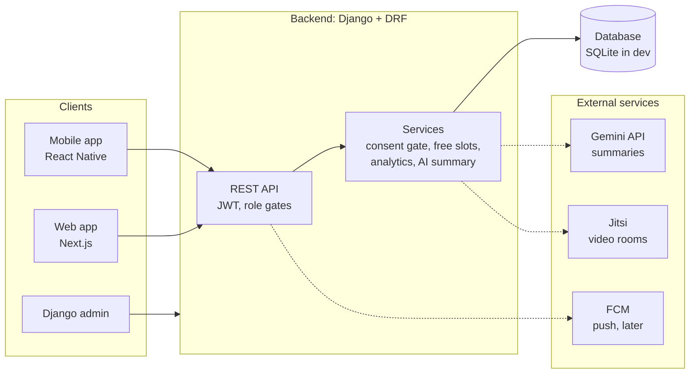
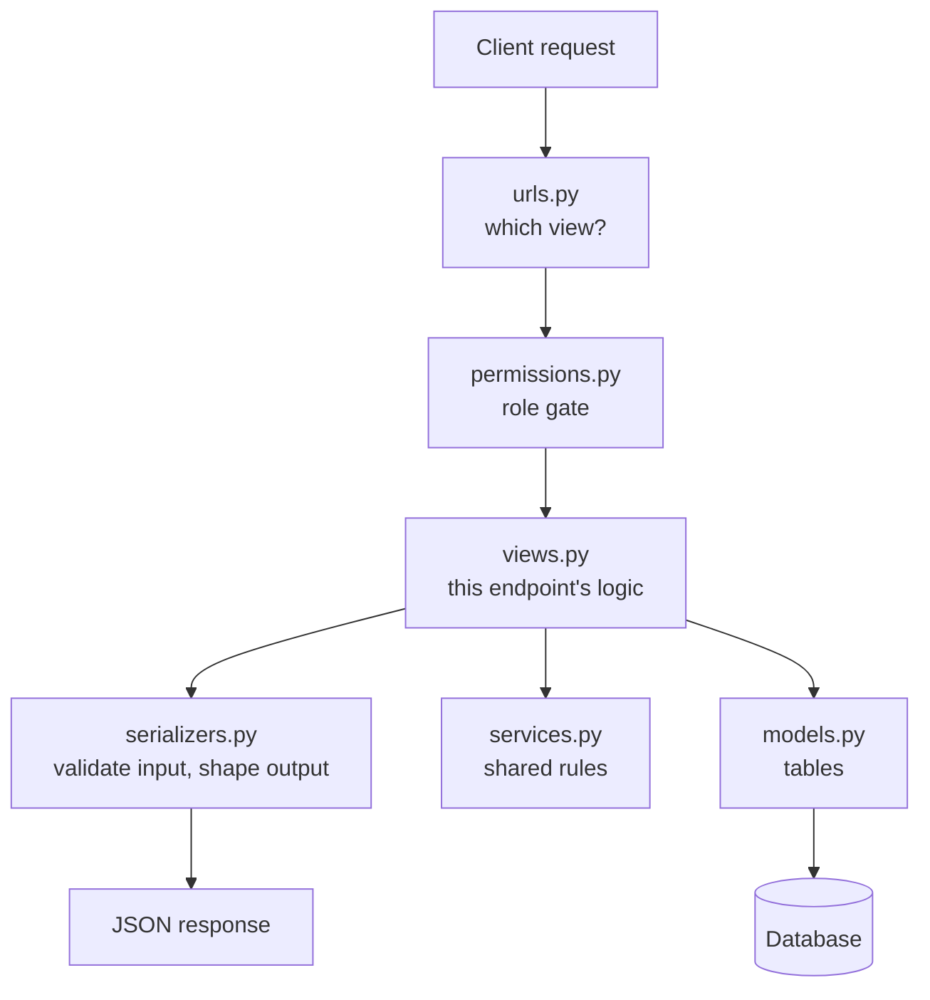
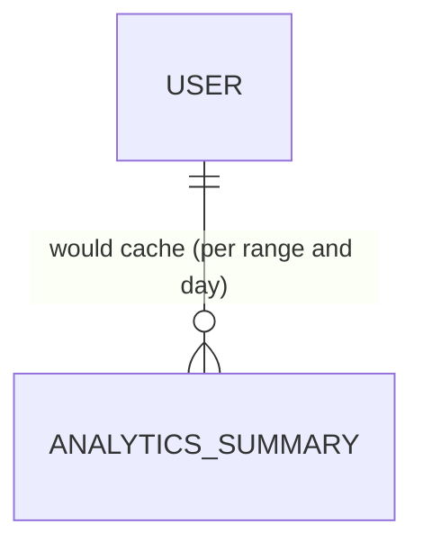
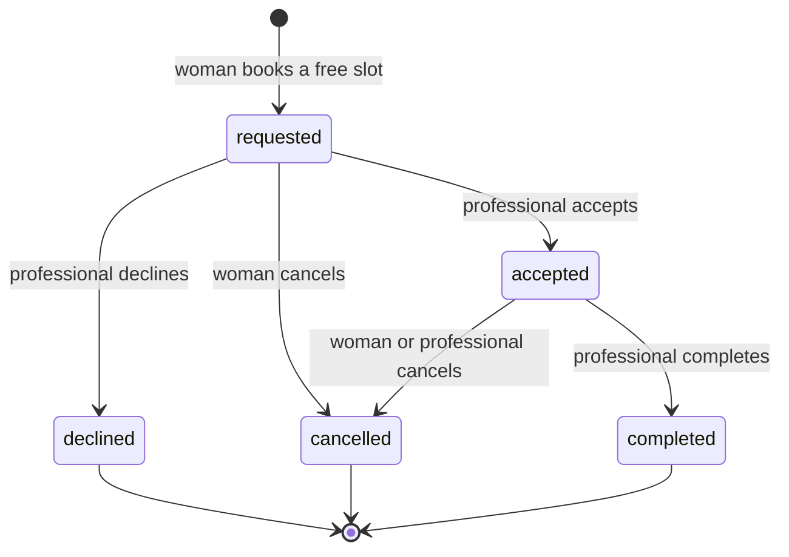
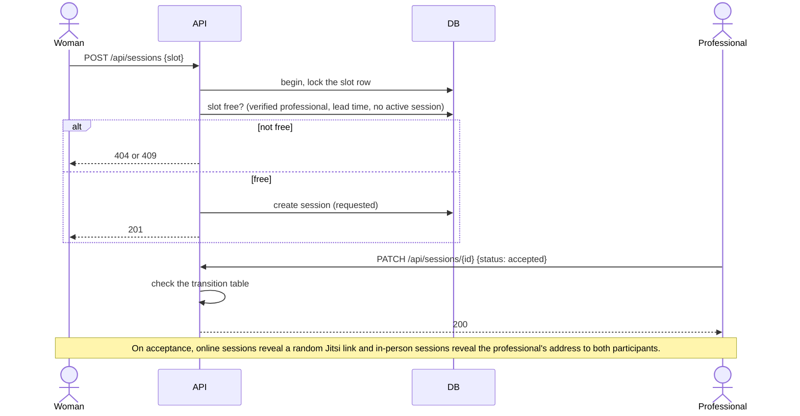
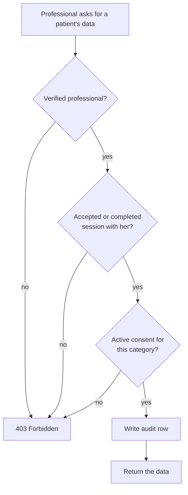
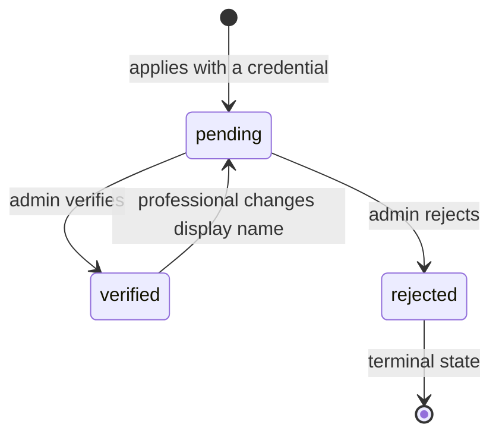
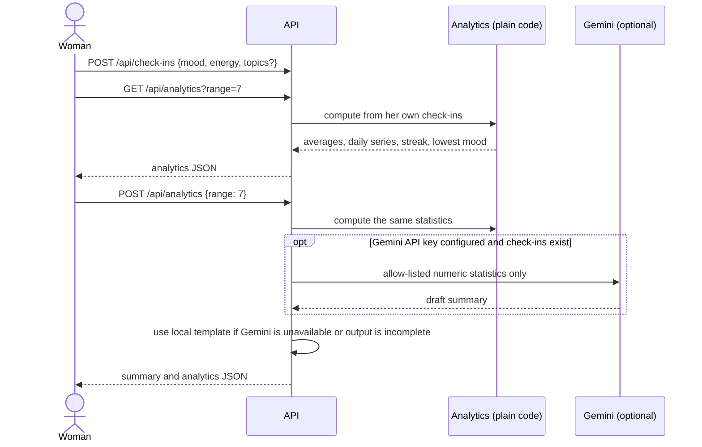
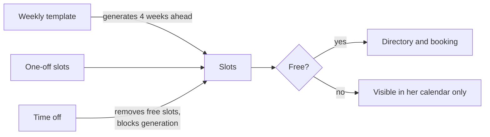

# Rahati

A private mental-wellbeing platform for Algerian women. A woman can understand her own emotional patterns through daily check-ins and her own numbers, learn from short educational cards, and, when she wants, reach a verified woman mental-health professional and book a session online or in person.

> **Status: work in progress.** 

---

## Table of contents

1. [Principles](#principles)
2. [What the product does](#what-the-product-does)
3. [AI and analytics](#ai-and-analytics)
4. [Architecture](#architecture)
5. [Backend structure](#backend-structure)
6. [Data model](#data-model)
7. [Key flows](#key-flows)
8. [Roles and permissions](#roles-and-permissions)
9. [API overview](#api-overview)
10. [Security and privacy](#security-and-privacy)
11. [Getting started](#getting-started)
12. [Testing](#testing)
13. [Key decisions](#key-decisions)
14. [Roadmap](#roadmap)
15. [Contributing](#contributing)
16. [Glossary](#glossary)
17. [License](#license)

---

## Principles

These rules decide every design question. If a feature breaks one, the feature changes.

- **Show, don't diagnose.** The app shows a woman her own numbers. It never labels her, never says she has a condition and never gives medical advice.
- **No model training.** Analytics use plain statistics. Optional AI summaries receive only an allow-listed subset of those statistics, never journal text or other free-text user content.
- **Anonymous by default.** A nickname is enough to sign up. Email and phone are optional.
- **Her data, her consent.** A professional sees a woman's data only with an accepted session and an explicit, revocable consent for each category (mood, journal, cycle).
- **Delete means delete.** One action removes everything she owns.
- **A woman does not face barriers to help.** Finding a professional is facilitated 

## What the product does

Rahati has two modes that share one account.

**Preventing: understand yourself.**
The backend accepts daily mood and energy check-ins with an optional fixed set of translated topic tags, cycle start dates, and encrypted journal entries. It serves curated cards and to-dos, and provides check-in analytics with an optional AI-generated summary.

**Healing: reach a professional.**
Find a verified woman professional by mode (online/in person), wilaya and time, book a free slot, and share selected data after granting consent. When the professional accepts, an online session gets a private Jitsi room link and an in-person session reveals the professional's address to the two participants.

Three personas use the platform:

| Persona | Uses | Does |
|---|---|---|
| **Woman (user)** | API; client UI  implemented | Tracks, learns, books, controls her sharing |
| **Professional** | API; dashboard  implemented | Manages availability, accepts sessions, sees consented data, assigns cards and to-dos |
| **Admin** | Django admin | Verifies professionals, reviews credentials, manages content |

Audit events are recorded in the database, but there is no admin page for browsing them yet.

## AI and analytics

Analytics are calculated on request from the authenticated woman's own check-ins using plain statistics; no model is trained and no prediction is made. `GET /api/analytics?range=7|30|90` returns start and end dates, a daily mood and energy series, check-in count, averages, previous-period mood average and change, current streak, and lowest mood with its dates. The `topics` response field is currently empty; topic aggregation is not implemented.

`POST /api/analytics` accepts the same ranges and returns the statistics plus a summary in the woman's selected language (Arabic, French, or English). With check-ins and `GEMINI_API_KEY` configured, the backend asks Gemini to write the summary using an explicit allow-list of numeric statistics: range, count, averages, mood change, and streak. Journal entries and other free-text user content are not sent. Without a key or check-ins, or when Gemini errors or its output fails the basic completeness or language-service availability checks, the backend returns a locally generated summary. These checks do not confirm that each generated claim matches the statistics, and the requested sentence count is not enforced; verify generated summaries against the returned `analytics` object. Both endpoints are private, authenticated user endpoints and return `Cache-Control: private, no-store`.

Summaries are informational and are not a diagnosis or medical advice. The prompt instructs Gemini not to diagnose, give medical advice, or invent facts, but that instruction is not a factual-accuracy safeguard.


## Architecture





### How a request is handled



Private endpoints use role and ownership checks. Professional reads of a woman's check-ins, journal, or cycle data also require an accepted relationship and active category consent (`services.can_read`).

## Backend structure

```
Rahati/
├── README.md
├── LICENSE
├── Backend/requirements.txt  tracked backend dependencies
└── Backend/
    ├── manage.py
    ├── config/               settings.py, urls.py
    └── rahati/
        ├── models.py         the tables
        ├── serializers.py    validation and response shapes
        ├── permissions.py    role gates
        ├── services.py       consent gate, relationship check, audit
        ├── views.py          one class per endpoint
        ├── urls.py           routes only
        ├── admin.py          the admin persona
        └── tests/            automated tests
```


## Data model

### Core (built)

```mermaid
erDiagram
  USER ||--o| PROFESSIONAL_PROFILE : "has, if professional"
  USER ||--o{ CHECK_IN : records
  CHECK_IN ||--o{ CHECK_IN_TOPIC : tags
  TOPIC ||--o{ CHECK_IN_TOPIC : "tagged in"
  TOPIC ||--o{ TOPIC_TRANSLATION : "has translations"
  USER ||--o{ CYCLE_START : logs
  USER ||--o{ JOURNAL_ENTRY : writes
  CHECK_IN o|--o{ JOURNAL_ENTRY : "may link"
  PATTERN_TYPE ||--o{ USER_PATTERN : detects
  USER ||--o{ USER_PATTERN : has
  WEEKLY_SUMMARY o|--o{ USER_PATTERN : summarizes
  USER ||--o{ WEEKLY_SUMMARY : receives
  PATTERN_TYPE o|--o{ CONTENT_CARD : "may group"
  TOPIC o|--o{ CONTENT_CARD : "may group"
  USER o|--o{ CONTENT_CARD : authors
  USER o|--o{ CONTENT_CARD : reviews
  CONTENT_CARD ||--o{ CONTENT_CARD_TRANSLATION : "may have translations"
  USER ||--o{ CARD_READ : marks
  CONTENT_CARD ||--o{ CARD_READ : "marked as read"
  USER ||--o{ TODO : owns
  CONTENT_CARD o|--o{ TODO : "may source"
  USER o|--o{ TODO : assigns
  USER ||--o{ AVAILABILITY_SLOT : offers
  WEEKLY_AVAILABILITY o|--o{ AVAILABILITY_SLOT : generates
  USER ||--o{ WEEKLY_AVAILABILITY : defines
  USER ||--o{ TIME_OFF : blocks
  AVAILABILITY_SLOT ||--o{ SESSION : "booked as"
  USER ||--o{ SESSION : books
  SESSION ||--o| SESSION_NOTE : has
  USER ||--o{ SHARING_CONSENT : grants
  USER ||--o{ SHARING_CONSENT : "is recipient professional"
  USER ||--o{ DEVICE_TOKEN : registers
  USER o|--o{ AUDIT_LOG : acts

  USER {
    string username "the nickname"
    string role "user, professional, admin"
    string language "ar, fr"
  }
  PROFESSIONAL_PROFILE {
    string display_name
    string wilaya
    string status "pending, verified, rejected"
  }
  CHECK_IN {
    date checkin_date
    int mood "1 to 5"
    int energy "1 to 5"
  }
  CONTENT_CARD {
    string status "draft, published, archived, removed"
    string starter_key "optional, unique"
  }
  AVAILABILITY_SLOT {
    datetime starts_at
    datetime ends_at
    string mode "online, in_person"
    string source "manual, template"
    datetime closed_at
  }
  WEEKLY_AVAILABILITY {
    int weekday "Monday=0 through Sunday=6"
    time starts_at "local time"
    time ends_at "local time"
    string mode "online, in_person"
    boolean is_active
  }
  TIME_OFF {
    datetime starts_at
    datetime ends_at
  }
  SESSION {
    string status "requested, accepted, declined, cancelled, completed"
  }
  SHARING_CONSENT {
    string category "mood, journal, cycle"
    datetime revoked_at
  }
  AUDIT_LOG {
    string action
    string target_type
    int target_id "not a foreign key"
  }
```



`USER_PATTERN` stores rule-detected patterns; `WEEKLY_SUMMARY` stores a generated weekly text summary. Analytics are computed on request and are not stored in an analytics-summary table. Card translations are stored per language, but the database does not enforce that a card has any translations; publishing validation checks required translations.

Design notes:

- **Normalization:** the model keeps topic names and card text in translation tables, and derives a session's professional through its availability slot.
- **Encrypted columns:** journal text and session notes are encrypted before they reach the database.
- **Deletion:** user-owned records generally cascade when their user is deleted. Audit rows remain, with the actor link set to `NULL`; their target type and ID are not foreign keys.
- **Translations** live in their own table, so adding a language adds rows, not columns.

### Planned additions



`ANALYTICS_SUMMARY` is a proposal only; no such model or cache is implemented.

## Key flows

### Session lifecycle

A session in `requested` or `accepted` holds its slot. When it becomes declined, cancelled or completed, the slot is free again (completed sessions stay in history).



### Booking and reveal



**A free slot** is: at least 60 minutes in the future, belongs to a verified and active professional, is not closed, and has no requested or accepted session. Search, calendar and booking all use this one rule.

### Consent gate



### Professional verification



Only pending profiles can be verified or rejected through the admin actions. An unverified professional cannot publish slots, accept sessions or read patient data, and her slots are not free for women. Rejected profiles have no reapplication or reconsideration flow yet.

### Analytics and AI summary

The API supports analytics and summary requests. Topic aggregation and content-card suggestions based on recent check-in topics are not part of the analytics response.



### Professional availability



A slot that has ever had a session is closed, never deleted, so booking history is never lost.

## Roles and permissions

| Action | Woman | Professional (verified) | Professional (pending or rejected) | Admin |
|---|---|---|---|---|
| Register | yes, public | yes, as an application | n/a | created by operators |
| Track, journal, to-dos | own data only | no | no | no |
| Book and cancel sessions | yes | no | no | no |
| Publish slots, accept sessions | no | yes | no | no |
| Read a woman's mood, journal or cycle | no | only with relationship + consent | no | no |
| Assign to-dos and cards | no | to her own patients | no | no |
| Verify professionals, manage cards | no | no | no | yes |
| Browse audit events in the admin UI | no | no | no | not implemented |
| Read journals, check-ins, notes | own only | consented only | no | no |

## API overview

All routes are under `/api/`. Responses are JSON. Authentication is a JWT in the `Authorization: Bearer` header.

### Built

| Area | Endpoints |
|---|---|
| Auth and account | `POST auth/register`, `POST auth/register-professional`, `POST auth/login`, `POST auth/refresh`, `POST auth/verify`, `POST auth/logout`, `POST auth/change-password`, `GET/DELETE me` |
| Professional profile | `GET/PATCH pro/profile`, `GET/PUT pro/profile/credential` |
| Tracking | `GET/POST check-ins`, `GET topics`, `POST cycle-starts`, `GET/POST journal`, `GET patterns` (reads stored pattern and weekly-summary rows) |
| Analytics and summaries | `GET analytics?range=7\|30\|90`, `POST analytics` (statistics and localized summary) |
| To-dos | `GET/POST todos`, `PATCH/DELETE todos/{id}`, `POST todos/{id}/complete`, `POST todos/{id}/reopen` |
| Content cards | `GET content-cards`, `GET content-cards/{id}`, `POST content-cards/{id}/read`, `GET content-cards/library?topic&limit&offset`, `POST content-cards/{id}/add-todo` |
| Professional content | `GET/POST pro/content`, `GET/PATCH/DELETE pro/content/{id}`, `POST pro/patients/{id}/content` (assign a card) |
| Directory | `GET wilayas`, `GET professionals?mode&wilaya&from&to&time_of_day`, `GET professionals/{id}/slots`, `GET professionals/{id}/calendar?month=YYYY-MM` |
| Sessions | `GET/POST sessions`, `GET/PATCH sessions/{id}` (participant-scoped details and status transitions) |
| Consent | `GET/PUT consents` |
| Professional availability | `GET/POST/PATCH/DELETE pro/slots`, `GET/POST/PATCH/DELETE pro/availability`, `GET/POST/DELETE pro/time-off`, `GET pro/calendar?from=YYYY-MM-DD&to=YYYY-MM-DD` |
| Professional care | `GET pro/patients`, `GET pro/patients/{id}/check-ins`, `.../journal`, `.../cycle`, `GET/POST pro/patients/{id}/todos`, `PATCH/DELETE pro/patients/{id}/todos/{todo_id}`, `GET/PUT pro/sessions/{id}/note` |

The Django admin supports professional verification and credential review, and content-card review and publishing. Audit events are stored but are not exposed in the admin UI. `GET patterns` only returns stored rows; analytics are computed on request and are separate from stored pattern and weekly-summary rows. Professional patient analytics are not implemented.

`GET /api/topics` returns `[{ "code": "stress", "name": "ضغط" }]` in the authenticated caller's language, ordered by code. A check-in response has exactly these keys:

```json
{
  "id": 1,
  "checkin_date": "2026-10-24",
  "mood": 3,
  "energy": 4,
  "topics": ["stress"]
}
```

`POST /api/check-ins` may omit `topics` to leave an existing day's tags unchanged, or provide a list of up to three distinct topic codes to replace them (an empty list clears them). Topics on professional check-in reads are included only when the existing mood-consent gate allows that read.

Every woman-facing card item has exactly these keys: `id`, `topic`, `topic_name`,
`title`, `body`, `action`, `support_note`, `pattern`, `source`, `author_name`,
`read`, `has_open_todo`, `reviewed_by_name`, and `language`.
`GET /api/content-cards/library` returns
`{ "count": 0, "next": null, "previous": null, "results": [] }`; library item
bodies are empty and are fetched from the detail endpoint. Suggestions use only the
woman's topic tags from the latest 14 local days. Woman-facing card responses use
`Cache-Control: private, no-store`.

From `Backend/`, `uv run python manage.py seed_starter_cards` seeds the six existing
pattern cards plus nine topic demo cards, publishes them for the woman-facing API,
and seeds the fixed topic vocabulary if needed. The fixture contains demo placeholder
content; review and replace it before serving real users.

### Specified (not yet built)

| Area | Endpoints |
|---|---|
| Professional patient analytics | `GET pro/patients/{id}/analytics` |

A machine-readable API schema (Swagger, via `drf-spectacular`) is not implemented yet. If added, it must not be public in production.


## Security and privacy

The security model follows **OWASP Top 10:2025** and the **OWASP API Security Top 10:2023**. The **OWASP Top 10 for LLM Applications** also applies to the analytics-summary feature.

### What is in place

- Role gates and ownership checks on private endpoints; consent gates on professional reads of a woman's check-ins, journal, and cycle data (A01, API1, API5).
- Journal text and session notes are encrypted at rest (A04).
- Responses are explicit allow-lists, with no emails, phones or file paths leaking (API3).
- Booking uses a row lock so a slot cannot be double-booked.
- Online meeting links use a cryptographically random room name, are generated only when the professional accepts, and are revealed only to the session participants while it is accepted (API1, API3, A02).
- Professional reads of a woman's data are written to the audit-log table (A09); there is no admin browser for these rows yet.
- Administrators cannot open check-ins, journals or session notes.
- Directory search has allow-listed parameters, result caps, throttles, and private no-store responses; requests are not logged (A05, API4, API6, A09).
- Slots with booking history are closed, not deleted (A08).

### AI summary privacy and limitations

- The summary service sends Gemini only an allow-listed subset of numeric statistics, never the woman's journal text or other free-text user content.
- A local template is used when Gemini is not configured, has no check-ins to summarize, fails, or returns an empty or obviously incomplete response. The current response checks do not validate factual accuracy or screen for prohibited claims; improve these safeguards before relying on summaries in a production care setting (LLM01, LLM02, LLM05, API10).
- Summary-specific caching and daily call caps are not currently implemented (LLM10, API4).
- Online session links need an HMAC or equivalent server-side derivation and must be visible only to session participants during a limited time window (A04, A01).

### Before any real woman uses the app (demo-minimum)

1. Confirm production secrets, `DEBUG`, `ALLOWED_HOSTS`, encryption key, and CORS origin are set safely.
2. Add a password confirmation step to `DELETE /me`.
3. Add throttling to public patient registration; login and professional registration are throttled already.
4. Add an admin audit-log viewer and review the audit-log retention/tamper policy.
5. Run `pip-audit` and `bandit -r rahati -x rahati/tests` before deployment (install the tools in the project environment first).

### Before a real launch

The full baseline: CI for backend unit and security tests (the Playwright E2E workflow is present), an immutable audit log, encryption key rotation, an admin IP allow-list and stronger admin authentication, a role-by-route test matrix, structured logging with redaction, and a `SECURITY.md` mapping every OWASP item to code and tests.

### Accepted risks (for now)

- Mood and cycle data are not encrypted per column (they are needed for aggregation). The database disk and backups must be encrypted at the hosting level.
- Integer ids are sequential; object-level checks are the protection.
- Administrators have no two-factor login yet.
- Wilaya, address and other professional details are only as trustworthy as the manual verification of her credential. A human must check a diploma against the official body.

## Deploy the backend on Render

The repository root contains `build.sh`, `pyproject.toml`, and `uv.lock`; the Django
project is in `Backend/`. In Render, set **Root Directory** to the repository root
(the folder containing those three files), not `Backend` or `Backend/rahati`.

Create a PostgreSQL database in Render first, then create a Python web service for
this repository with:

| Setting | Value |
| --- | --- |
| Root Directory | repository root |
| Build Command | `bash build.sh` |
| Start Command | `cd Backend && uv run --project .. gunicorn config.wsgi:application --bind 0.0.0.0:$PORT` |

Add these environment variables to the web service. Copy the PostgreSQL database's
**Internal Database URL** into `DATABASE_URL`:

```text
DJANGO_DEBUG=false
DJANGO_SECRET_KEY=<unique-long-random-secret>
FIELD_ENCRYPTION_KEY=<unique-Fernet-key>
DATABASE_URL=<Render-PostgreSQL-Internal-Database-URL>
```

Generate keys locally with:

```powershell
python -c "import secrets; print(secrets.token_urlsafe(64))"
python -c "from cryptography.fernet import Fernet; print(Fernet.generate_key().decode())"
```

Keep the actual values in Render's environment settings, never in Git or this
README. `GEMINI_API_KEY` is optional. `build.sh` syncs dependencies from the root
uv lockfile, collects static files, applies migrations, and seeds the demo topics
and starter cards. The public health check is `https://<service>.onrender.com/api/health/`.

The current configuration permits all host names and CORS origins for the demo.
Before a public production launch, restrict these to the deployed domains. Uploaded
credential files currently use local storage, which is not durable across Render
deployments; configure private persistent/object storage before accepting real uploads.

## Deploy the backend on Vercel

The Django API can be deployed as its own Vercel project before the web frontend.
Vercel's Python runtime detects this app from `Backend/manage.py` and loads
`config.wsgi.application`. In the Vercel project, set **Root Directory** to
`Backend`; do not use the repository root for this backend project.

### 1. Provision production services

- Create a managed PostgreSQL database with TLS enabled. Do not use the repository's
  SQLite database for Vercel: function filesystems are not durable application storage.
- Arrange durable, private object storage for professional credential uploads before
  accepting those uploads. `PRIVATE_MEDIA_ROOT` currently points to a local directory;
  uploaded files can be lost between function invocations or deployments. Do not use
  `/media/` or a public bucket for credentials.
- Keep encrypted backups of the database and `FIELD_ENCRYPTION_KEY`. Losing that key
  makes encrypted journal entries and session notes unreadable.

### 2. Create the Vercel backend project

Import the Git repository into Vercel and set its Root Directory to `Backend`.
Use the Python framework preset if asked. The project needs no custom build command;
Vercel detects Django from `manage.py`. Add the environment variables below to the
Production environment (and Preview only if you have a separate preview database).
Use the Vercel-provided PostgreSQL connection URL as `DATABASE_URL`.

```text
DJANGO_DEBUG=false
DJANGO_SECRET_KEY=<unique-long-random-secret>
DJANGO_ALLOWED_HOSTS=<your-backend-domain>,<your-project>.vercel.app
FIELD_ENCRYPTION_KEY=<unique-Fernet-key>
DATABASE_URL=<managed-PostgreSQL-URL>
```

Generate keys locally with:

```powershell
python -c "import secrets; print(secrets.token_urlsafe(64))"
python -c "from cryptography.fernet import Fernet; print(Fernet.generate_key().decode())"
```

Keep the actual values in Vercel's environment variable settings, never in Git or
the README. `GEMINI_API_KEY` is optional. Set `CORS_ALLOWED_ORIGINS` to the exact
frontend HTTPS origin when that frontend has been deployed. Until then the API can
be checked directly; the default only permits localhost.

### 3. Initialize the database

After the first deployment succeeds, run migrations against the production database
from a trusted local checkout with the Production environment variables loaded:

```powershell
cd Backend
python manage.py migrate
python manage.py createsuperuser
```

Use the host's documented secure environment pull workflow or set those variables
in the local process; never paste them into a committed file. Verify `/admin/` over
HTTPS and check a known API route. The Django admin is authenticated.

### 4. Deploy the frontend later

Create a separate Vercel project rooted at `frontend` when its UI is ready. Configure
the frontend's API base URL to the backend deployment, then set the backend's
`CORS_ALLOWED_ORIGINS` to the frontend's production HTTPS origin and redeploy the
backend. The current frontend is still the Next.js starter screen.

**Deployment status:** this is deployment setup guidance, not a claim that the app is
ready for public users. Complete the security work listed in “Before any real woman
uses the app” and add durable private credential storage before onboarding real users.

## Getting started

Requirements: Python 3.12 or newer (Django 6.1 requirement). Node.js 22 and npm are needed for the frontend E2E suite.

```bash
# from the repository root
python -m venv .venv
# Windows PowerShell:
.\.venv\Scripts\Activate.ps1
# macOS/Linux: source .venv/bin/activate
python -m pip install -r Backend/requirements.txt

cd Backend
```

Create `Backend/.env`:

```
FIELD_ENCRYPTION_KEY=<generate it, see below>
# Optional: enables Gemini-generated analytics summaries
GEMINI_API_KEY=<your Gemini API key>
```

Generate the encryption key:

```bash
python -c "from cryptography.fernet import Fernet; print(Fernet.generate_key().decode())"
```

> **Back up this key.** If it is lost, every journal entry and session note becomes unreadable.

Required settings in `Backend/config/settings.py` (the project reads them at the bottom of the file):

```python
AUTH_USER_MODEL = "rahati.User"          # must be set before the first migration
FIELD_ENCRYPTION_KEY = os.environ["FIELD_ENCRYPTION_KEY"]
TIME_ZONE = "Africa/Algiers"
INSTALLED_APPS += ["rest_framework", "corsheaders", "rahati"]
```

Create the tables and an administrator:

```bash
python manage.py makemigrations rahati
python manage.py migrate
python manage.py createsuperuser
python manage.py shell -c "from rahati.models import User; User.objects.filter(is_superuser=True).update(role='admin')"
python manage.py runserver
```

- Admin: `http://127.0.0.1:8000/admin/`
- API: `http://127.0.0.1:8000/api/`

**Do not commit** `.env`, `db.sqlite3`, `private_media/` or `media/`. If `db.sqlite3` was committed by mistake, run `git rm --cached Backend/db.sqlite3`.

## Testing

### Demo-video data

Run `seed_demo` only against an isolated demo database. In PowerShell:

```powershell
cd Backend
$env:DEMO_SEED_ALLOWED = "true"
$env:DEMO_SHARED_PASSWORD = "<choose a password with at least 16 characters>"
python manage.py seed_demo
python manage.py seed_demo --refresh
```

`--refresh` moves demo check-ins, slots, and session times forward to the current
date. Without a shared password, the command generates random passwords and does
not print them.

```bash
cd Backend
python manage.py test rahati
```

Coverage (once `coverage` is installed as a dev dependency):

```bash
coverage run manage.py test rahati
coverage report --include="rahati/*"
```

The backend tests protect consent, encryption at rest, deletion, booking correctness and role and ownership rules. They use local test data and do not call external services.

### End-to-end smoke tests

The Playwright suite starts the Next.js frontend and Django API, then tests the booking API with real HTTP requests. Its Django server migrates and seeds a fresh temporary SQLite database for every run; it does not use `Backend/db.sqlite3` or any staging data.

After creating the root `.venv` and installing `Backend/requirements.txt` above, run `npm ci` from `frontend/` and install the browser once with `npx playwright install chromium`. Then run `npm run e2e` from `frontend/`. The suite starts both servers and uses a fresh temporary SQLite database. GitHub Actions runs it with Chromium. Browser coverage of login and booking can be added when those screens exist.

## Key decisions

| Decision | Why |
|---|---|
| Rules and statistics, not machine learning | No real data yet, and a model trained on invented data proves nothing. Rules are explainable. |
| Show analytics instead of detecting "patterns" | Avoids clinical judgment, false alarms and responsibility for being right. |
| Cards by topic the woman tags, plus cards her professional assigns | The app never claims to know her state. She tells it, or her professional decides. |
| No filtering professionals by symptom, specialty, language or rating | A woman seeking help may not know what is wrong; ratings invite unfairness. |
| One user table with a role field | Three personas, one login system, one permission model. |
| Slots are closed, never deleted, after a booking | Deleting would cascade and erase booking history. |
| Video links generated by the server from a secret | Nothing stored to leak, nothing to guess. |
| SQLite now, a server database later | Zero setup for a team that is starting. Models do not change when switching. |

## Roadmap

Suggested build order (each item depends on the earlier ones):

1. Improve AI-summary validation, and add summary-specific caching and daily call caps.
2. Add professional patient analytics, an API schema for client developers, and a visible "talk to someone now" support card.
3. Before a real launch: the full OWASP baseline, a production database, hosting with TLS and encrypted storage, push notifications.

**People work that code cannot replace:** professionals to review the card texts and the AI wording, native speakers for the Arabic, a human check of every professional's credential, and a pilot with consenting women.

## Contributing

- Work on a branch and open a pull request; every pull request must pass `python manage.py test rahati` from `Backend/` with the project virtual environment active.
- Every new endpoint needs: an explicit role gate, ownership scoping, a strict serializer with an explicit field list (never `__all__`), a text policy for every string field, pagination for lists, a throttle scope, an audit event for sensitive actions and tests for each of these.
- Never log request bodies, tokens, journal text, addresses or video links.
- Never commit secrets. Add new environment variables to `.env.example`.
- Do not delete a test to make a change pass. If a test must change, say why in the pull request.

## Glossary

- **Check-in**: a daily mood and energy score (1 to 5).
- **Slot**: a block of time a professional offers. A **free slot** can still be booked.
- **Session**: a booking of a slot by a woman, with a status.
- **Consent**: a woman's permission for one professional to see one category of her data.
- **Card**: a short lesson with one small action and a "when to reach out for support" line.
- **Topic**: a fixed translated theme (such as stress, sleep or family) that can be attached to a check-in.
- **Wilaya**: an Algerian administrative province, used as the location filter.

## License

See [LICENSE](LICENSE).
