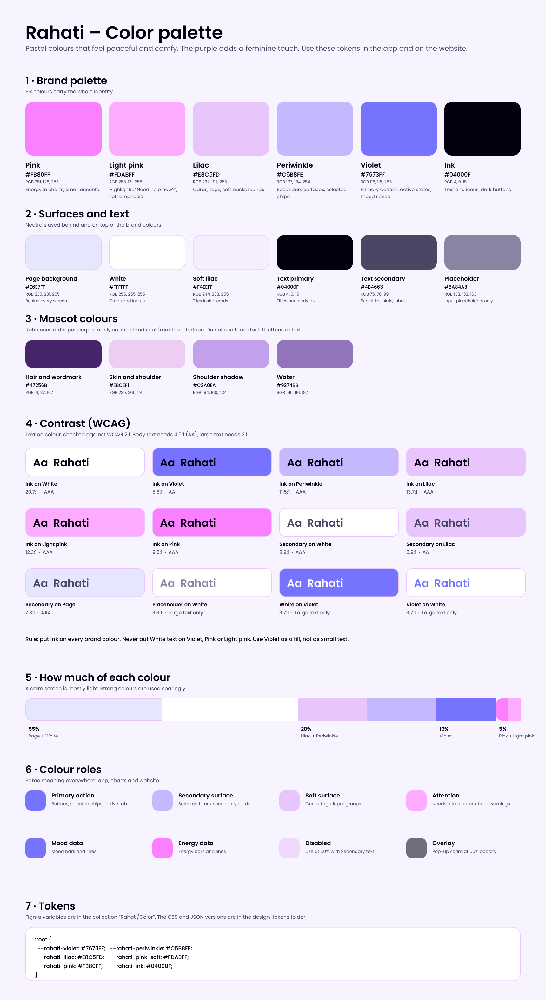

# Rahati – Mobile application

> A quiet place for how you feel.

This folder documents the **design of the Rahati mobile application**: who it is for, how we studied their needs, how a woman moves through the app, and the visual identity I created for it.

It is written from three points of view, because I worked on this project as its **product designer**, its **UX researcher** and its **graphic designer**.

The backend, API and security model are documented in the [main README](../README.md). This file explains the *why* behind the screens.

---

## Contents
1. [My role](#1-my-role)
2. [User research](#2-user-research)
3. [User personas](#3-user-personas)
4. [Design principles](#4-design-principles)
5. [User workflow](#5-user-workflow)
6. [Screens](#6-screens)
7. [Visual identity](#7-visual-identity)
8. [Prototype](#8-prototype)
9. [Limits and next steps](#9-limits-and-next-steps)

---

## 2. My role

| Hat | What I did |
|---|---|
| **UX researcher** | Designed and ran two questionnaires (one for the target audience, one for mental-health professionals), analysed the answers and turned them into design decisions. |
| **Product designer** | Defined the features, the user workflow, the screens and the consent flow. Built the clickable prototype in Figma. |
| **Graphic designer** | Created the visual identity: the **Raha** mascot, the colour palette and the typography. |

---

## 3. User research

I did not want to design for women from assumptions. Mental health is a sensitive subject in Algeria, so before drawing a single screen I asked the people who would use the app, and the professionals who would receive its requests.

### 3.1 Method

Two questionnaires, one for each side of the product:

| Form | Audience | Language |
|---|---|---|
| [Rahati – Questionnaire for Potential Users](https://docs.google.com/forms/d/e/1FAIpQLSftbZfjMgYBOD1OVPPmr-K4PKIw_VeaCAvTJZSlMcrhWwg4ZA/viewform?fbzx=944980987012511140) | Women who could use the app | English |
| [Rahati – Questionnaire à destination des psychologues et professionnelles de la santé mentale](https://docs.google.com/forms/d/e/1FAIpQLSdo-SowedMhKNsHodQirYBS3jr4Q4zBSFd2lAh7vOqSnRsChA/viewform) | Psychologists and mental-health professionals | French |

Both forms start with the same promise: **nobody has to share personal experiences or sensitive information**. The questions are about habits, needs and barriers, never about a woman's own story. That choice mirrors the product itself.

### 3.2 From Research to Design

The questionnaires provided insights into both women's mental health needs and professionals' perspectives. I analysed the responses to identify recurring needs, concerns, expectations, and patterns.

I then translated these findings into three key design outputs:

- **User Personas:** Grouped common behaviours, goals, frustrations, and expectations into representative user profiles, helping us understand who we were designing for.
- **User Flows:** Mapped the main user journeys and interactions, from onboarding and daily mood check-ins to journaling, accessing resources, and connecting with a mental health professional. The flows also incorporated privacy preferences and consent requirements.
- **UI/UX Design:** Used the personas and user flows to guide the app's structure, navigation, features, and interface decisions, ensuring that each screen addressed an identified user need while considering professionals' requirements and privacy concerns.

This research-driven process helped turn raw questionnaire data into practical design decisions and shaped the overall Rahati mobile app experience.

### 3.3 Results

### Target audience

**Understanding the women**

Analysing the questionnaire responses helped me understand that women's mental wellbeing journeys are different, and that seeking support can be difficult for several reasons. I identified key user needs and concerns, including:

- The need for a safe and private space to express emotions without fear of judgement.
- The importance of having simple ways to monitor mood and recognise emotional patterns.
- The need for accessible and reliable mental health information.
- The desire to connect with professionals when support is needed, without feeling pressured.
- The importance of giving users control over their personal information and what they choose to share.

**Understanding the professionals**

The professionals' responses helped me understand the other side of the experience:

- What information could help them better understand a patient's situation before a session.
- How tracking progress between sessions could support follow-up.
- Why communication and data sharing should respect professional boundaries.
- The importance of consent, confidentiality, and keeping the app a support tool rather than a replacement for professional care.

**How these insights shaped the design**

I used these findings to build user personas that represented the users' goals, behaviours, frustrations, and expectations. I then translated their needs into user flows and used those flows to guide the app's navigation, features, screen structure, and interactions.

This ensured that the Rahati experience was based on the people it was designed to support, rather than assumptions about what they might need.

### 3.3 From findings to decisions
| Theme from the research | Finding | Design decision |
|---|---|---|
| Privacy and fear of being judged | • Fear of judgment or social stigma • High concern over data privacy and unauthorized data sharing • Preference for remaining anonymous | A **nickname and a password are enough** to sign up. Email and phone are optional. Nobody sees a real name. |
| Women do not know where to start | • Difficulty understanding emotions and mood changes • Lack of time and lack of reliable mental health information | A **20-second check-in** and short cards ("Short lessons, at your own pace") instead of long articles. |
| Seeing progress without being labelled | • Strong interest in tracking daily mood/energy levels over time • Preference among many respondents to use self-care/tracking features independently | The app shows **her own numbers** (weekly bars, averages, streak). It never says she has a condition. |
| Finding a professional is hard | • Difficulty finding a trusted, verified woman psychologist or therapist • Concerns surrounding service costs and accessibility | **Search by how, where and when**: online or in person, wilaya, date and time of day. Only **verified women**. |
| Trust in sharing data | • Persistent fear of data being shared without consent • Need for explicit privacy and confidentiality guarantees | A **consent pop-up with three checkboxes** (journal, statistics, cycle). Skipping shares nothing. It can be changed at any time. |
| Professionals need context, not everything | • Desire to keep personal journal entries private • Need for clear boundaries between personal self-care data and shared medical context | The professional sees **only the categories the woman allowed**, and only after a session is accepted. |

---

## 4. User personas

These personas are **composites**. They summarise the patterns that appeared in the research; they are not real individuals. Adjust the details so that they match your results.

### Persona 1 – Nour, the quiet beginner

| | |
|---|---|
| **Age / city** | 22, student, Algiers |
| **Languages** | Arabic and French |
| **Situation** | Feels stressed and sleeps badly during exams. Has never spoken to a professional. |
| **Goals** | Understand why some days feel heavier. Have a private place for her thoughts. Maybe talk to someone one day. |
| **Frustrations** | Fears being judged. Does not know what to call what she feels. Finds long health articles overwhelming. |
| **What she needs from Rahati** | A sign-up with no real name. A check-in that takes seconds. Short lessons. A way to reach a woman professional *only when she is ready*. |

### Persona 2 – Amel, the woman ready to talk

| | |
|---|---|
| **Age / city** | 31, works full time, Sétif |
| **Languages** | Arabic |
| **Situation** | Has been feeling low for weeks and wants to see a woman psychologist, ideally near her. |
| **Goals** | Find a verified professional quickly, choose online or in person, and control what that person can see. |
| **Frustrations** | Cannot tell who is trustworthy. Hard to find a time slot. Worried about her journal being read. |
| **What she needs from Rahati** | Filters by wilaya and time. Clear free slots. A consent step where she chooses what to share. Her address or video link only after the session is accepted. |

### Persona 3 – Dr. Sara, the professional

| | |
|---|---|
| **Role** | Clinical psychologist, verified on Rahati |
| **Goals** | Manage her availability, accept or decline requests, and understand a patient's recent state before a session. |
| **Frustrations** | Back-and-forth messages to schedule. No context before a first session. Worry about handling data she should not see. |
| **What she needs from Rahati** | A dashboard with requests waiting and a calendar. Only the data a woman has agreed to share. Private session notes. |

---

## 5. Design principles

These principles come from the research and from the product rules in the main README. If a screen breaks one of them, the screen changes.

1. **Show, don't diagnose.** The app displays numbers and patterns, never labels.
2. **Quiet by design.** Calm colours, generous spacing, one main action per card.
3. **Anonymous by default.** A nickname is enough.
4. **Her data, her consent.** Sharing is opt-in, per category, and reversible.
5. **No barriers to help.** Finding a professional takes three choices: how, where, when.
6. **Short and kind.** Short check-in, short lessons, reassuring words ("Your space is just as you left it").

---

## 6. User workflow

The full workflow is split into five diagrams so that each one stays readable.

| # | Diagram | What it shows |
|---|---|---|
| 1 | [Get started](./workflow/1-get-started.png) | Landing, welcome, create account or log in, Home |
| 2 | [Track, journal and cycle](./workflow/2-track-journal-cycle.png) | Daily check-in, stats, journal, cycle |
| 3 | [Learn](./workflow/3-learn.png) | Library, topics, articles, to-dos |
| 4 | [Reach a professional](./workflow/4-reach-a-professional.png) | Search, book, consent, session lifecycle |
| 5 | [Professional side and account](./workflow/5-professional-and-account.png) | Dashboard, patient view, profile, delete |

### User Workflow Diagram 

---

## 7. Screens

| Area | Screens |
|---|---|
| **Onboarding** | Welcome, Create your safe space, Welcome back |
| **Home** | Next session, daily check-in, cycle tracker (four phases), today's small actions, your week, "This week in words", Learn something |
| **Stats** | Weekly mood and energy chart, check-in count, averages, streak, most on your mind |
| **Journal** | Write it down, link to today's check-in, earlier entries |
| **Therapy** | Find someone (how, where, date, time), results, consent pop-up, My sessions |
| **Learn** | Library, topic page, article with five bottom-bar states (default, added, read, error, list full) |
| **Profile** | Account settings, download data, log out, delete account |

---

## 8. Visual identity

As the graphic designer of the project, I wanted Rahati to *feel* like its name, which means **rest, comfort and ease**. The identity needed to be calm, warm and clearly made for women, without becoming childish or clinical.

### 8.1 Raha, the mascot

**Raha** is a woman resting her head on her shoulder, eyes closed, with water rippling beneath her. She is not smiling for a camera and she is not in distress: she is simply *at rest*, which is the feeling the app tries to give.

- The **closed eyes and relaxed posture** say "you can put things down here".
- The **water** under her echoes calm and flow, and gives the logo a stable base.
- The **soft, rounded shapes** keep her gentle and approachable.
- She appears on the welcome screen, the sign-up and login screens, and the app icon.

The mascot comes in four versions: the symbol alone, the symbol with the wordmark, a loose-hair version with the wordmark, and a compact version for small spaces.

### 8.2 Colour palette

The palette is made of **pastel colours** that are peaceful and comfy. The **purple adds a feminine touch** and gives the app a recognisable personality, while the soft tones keep the screens light.

| Swatch | Hex | Role |
|---|---|---|
| Pink | `#FB80FF` | Energy series in charts, accents |
| Light pink | `#FDABFF` | Highlights, "Need help now?", soft emphasis |
| Lilac | `#E8C5FD` | Cards, backgrounds, tags |
| Periwinkle | `#C5B8FE` | Secondary surfaces, selected chips |
| Violet | `#7673FF` | Primary actions, active states, mood series |
| Ink | `#04000F` | Text and icons |

The mascot uses a deeper purple family of its own so that she stands out from the interface:

| Hex | Use |
|---|---|
| `#47256B` | Hair, wordmark |
| `#EBCEF1` | Skin and shoulder |
| `#C2A0EA` | Shoulder shadow |
| `#9274BB` | Water |
**Color Palette Guide**

**Accessibility choices**

- Text on violet buttons is **ink**, not white, to keep a comfortable contrast.
- Meaning never relies on colour alone: charts use different shapes, empty days are dashed, and statuses are written out.

### 8.3 Typography

I chose **Poppins** for the whole interface.

- **Simple and rounded.** Its geometric, friendly letterforms match the soft shapes of the mascot and the rounded cards.
- **Very readable.** It stays clear at small sizes, which matters for hints, tags and dates on a phone.
- **Calm hierarchy.** Three weights are enough: Regular for body text, Medium for labels, SemiBold for titles and buttons.
- **Fits the purpose.** The app talks about sensitive topics, so the type should never shout. Poppins is neutral, warm and does not look clinical.

| Style | Use |
|---|---|
| SemiBold 28 | Screen titles |
| SemiBold 17 to 19 | Card titles |
| Regular 13 to 14 | Body text |
| Medium 11 to 12 | Tags and small labels |

Arabic text is part of the plan from the start, since Arabic is the default language. A dedicated Arabic typeface and a full right-to-left layout are listed in the next steps.

### 8.4 Components and shapes

- Large **rounded corners** (28 px on cards) for a soft, safe feeling.
- One **fixed bottom bar** with five tabs: Home, Stats, Therapy, Journal, Profile.
- **Capsule bars** for the weekly chart and a **ring** for check-ins, so numbers feel friendly and not clinical.
- A **consistent 26 px rhythm** between containers.

---

## 9. Prototype

The app is prototyped in Figma with clickable flows:

- Onboarding: Welcome → Create account or Log in → Home, with **smart animate at 300 ms**.
- Home → Library → Topic → Article.
- Therapy → Book → Consent pop-up → My sessions.
- Bottom navigation between the five main tabs.

### Interactive Prototype

Explore the Rahati mobile app prototype:

[View the Figma Prototype](https://www.figma.com/proto/7G9ZDSslsUWhYOFqTXAtQR/Rahati-Ui-Ux?node-id=2-768&p=f&viewport=-525%2C-980%2C0.3&t=3vXgiSGEKaAOpJnq-1&scaling=scale-down&content-scaling=fixed&starting-point-node-id=2%3A356&page-id=0%3A1)

---

## 10. Limits and next steps
- Run usability tests on the prototype with women from the target audience and with professionals.
- Design the **right-to-left (Arabic) version** of every screen, and choose the Arabic typeface.
- Design error and empty states for sign-up and login (nickname already used, password under 8 characters).
- Add the missing topic pages (Family, Work or study, Self-esteem, Relationships, Body or cycle, General) once their cards are written.
- Have every card text reviewed by a professional before real users see it.
